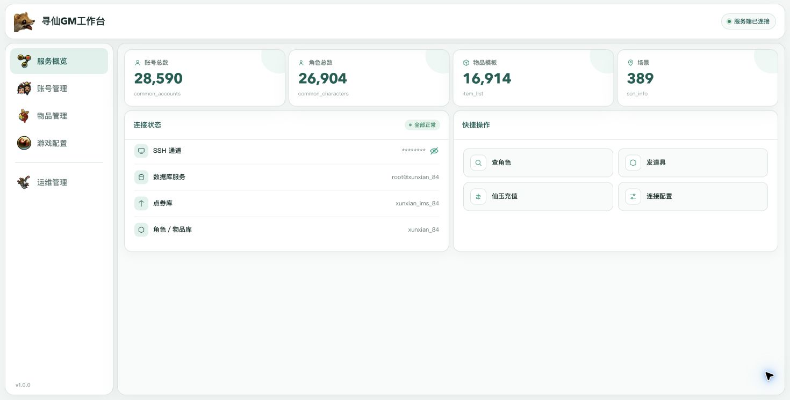
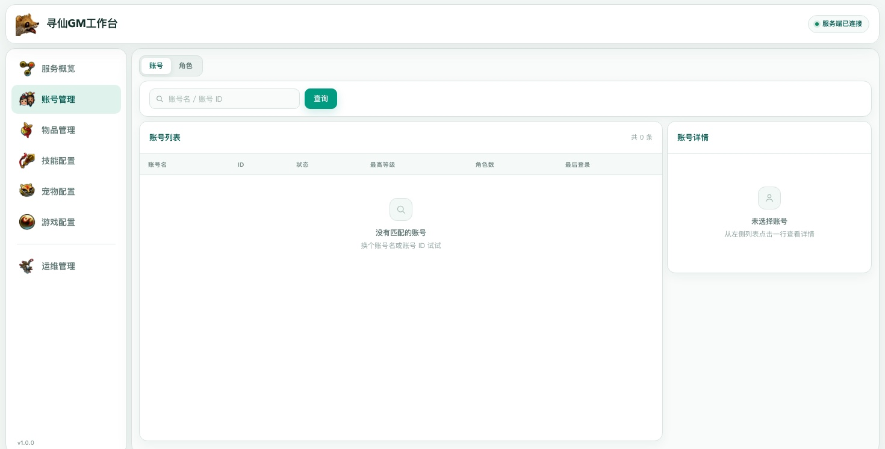
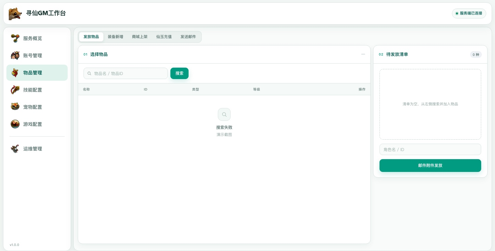
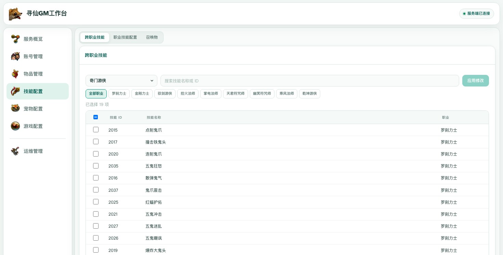
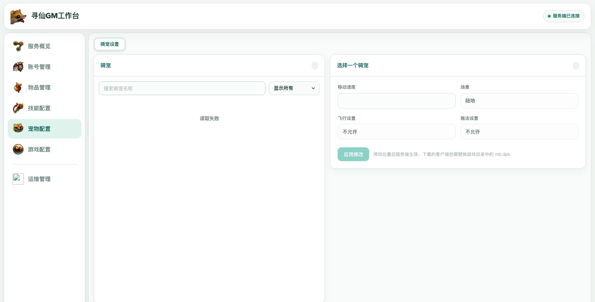
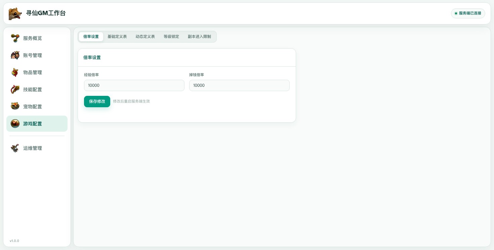
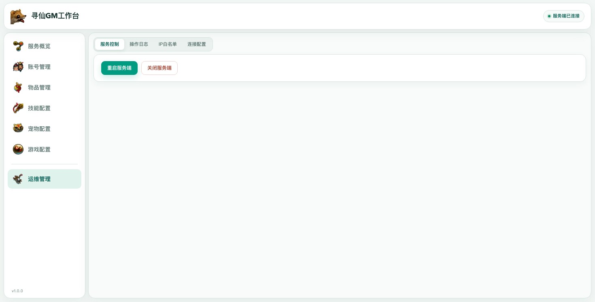

# 寻仙 GM 工作台

一个本地运行的寻仙游戏管理工具，通过网页界面连接游戏服务端，方便管理账号和角色、发放物品、发送邮件、充值仙玉、维护商城商品和游戏配置。

## 工作台截图

截图在页面数据载入完成后截取；账号标识和连接用户名已模糊处理。

### 服务概览



### 账号管理



### 物品管理



### 技能配置



### 宠物配置



### 游戏配置



### 运维管理



## 功能一览

- **服务概览**：查看工作台连接状态和常用功能入口。
- **账号管理**：查询账号与角色，查看详情并执行角色管理操作。
- **物品管理**：查询并发放物品，新增自定义武器，管理商城商品、背包商店、仙玉和邮件。背包商店可查看已保存商品，按 VIP／SVIP 范围添加或删除。上架走「先加清单、再进执行队列」：在左侧填好物品、售卖范围和售价后点「加入清单」（只暂存在页面，不写服务端），清单可以累积多件；点「全部加入执行队列」把这些上架项一次性放进右上角的修改队列，只有点「应用修改」执行队列时才会真正写入服务端散文件、热重载商人列表，并把商品记录和基础购买价写进客户端 `mb.dpk`，执行完成后自动下载最终客户端包。售价可用金或砖填写（1 砖 = 100 金 = 10,000 银 = 1,000,000 铜）。当原价与折扣无法精确表示填写的售价时，会按填写金额修改物品基础购买价，其他商人出售同一物品的金币售价也可能变化；回收价和使用效果保留。工作台会重载服务端配置表、刷新两条线路的原生商人缓存并回读实际商品列表，同时把商品记录和基础购买价写入客户端 `mb.dpk` 的商品表：游戏客户端按自己的商品表解析商品 ID 与折扣，只改服务端时商品不会出现在可购买状态。上架后需用下载到的客户端包替换游戏目录中的 `mb.dpk` 并重新登录。若原生刷新未通过验证，页面会报告未生效。商城上架、单件/批量下架后会自动热重载；新增武器支持写入客户端与服务端包并在服务控制热重载物品定义。
- **技能配置**：设置跨职业技能、职业技能冷却与距离，以及自定义召唤物。修改后可在服务控制选择对应范围热重载到普通线和交易线，无需重启服务端。替换客户端包后重新登录；召唤物需重新召唤。技能定义重载会清理正在运行的技能效果。
- **宠物配置**：调整骑宠和道具坐骑的移动速度、使用场景、飞行和乘骑施法设置。
- **游戏配置**：设置经验与掉钱倍率，编辑基础和动态定义表，调整等级锁定与副本进入次数。
- **运维管理**：多选热重载技能、骑宠设置、商城或新增武器，重启或关闭服务端、查看操作日志、管理 IP 白名单和连接配置。新增武器热重载让服务端读取新的物品定义；客户端仍需替换包并重新登录。

部分配置需要在「运维管理 → 连接配置」设置并保存客户端 `mb.dpk` 路径。生成的客户端包需按提示替换游戏目录中的 `mb.dpk`。技能、骑宠、商城和新增武器支持热重载；其他物品定义仍按各功能要求重启服务端。详见[技能热重载实现说明](doc/技能热重载实现说明.md)。

右上角修改队列会集中合并全部项目，每个有变化的服务端包只上传、备份和替换一次，客户端只下载最终的一份 `mb.dpk`。详见[修改队列批量写包说明](doc/修改队列批量写包说明.md)。

## 运行环境

- Python 3.13 或更新版本
- 能连接游戏服务端的 SSH 和 MySQL 配置

## 安装与启动

首次安装时，在项目目录打开终端，创建虚拟环境并安装依赖：

```bash
python3 -m venv .venv
source .venv/bin/activate
python -m pip install -r requirements.txt
```

之后每次启动，在项目目录运行：

```bash
source .venv/bin/activate
python gm_server.py
```

也可以直接运行虚拟环境中的 Python：

```bash
./.venv/bin/python gm_server.py
```

Windows PowerShell 首次安装：

```powershell
py -3.13 -m venv .venv
.\.venv\Scripts\Activate.ps1
python -m pip install -r requirements.txt
```

Windows PowerShell 日常启动：

```powershell
.\.venv\Scripts\Activate.ps1
python gm_server.py
```

启动后，在浏览器打开 <http://127.0.0.1:8899>。

## 首次连接

在工作台打开「运维管理」→「连接配置」，填写服务端 IP、SSH 登录信息、MySQL 账号和数据库名称，然后保存并测试连接。配置保存在项目目录的 `gm_config.json`，该文件包含密码，已加入 `.gitignore`。

工作台默认只监听本机地址 `127.0.0.1`。请勿将它暴露到公网。使用完毕后，在运行程序的终端按 `Ctrl+C` 退出。
